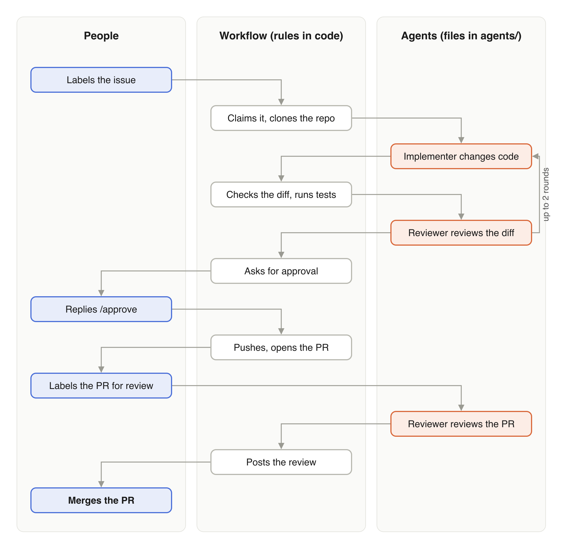
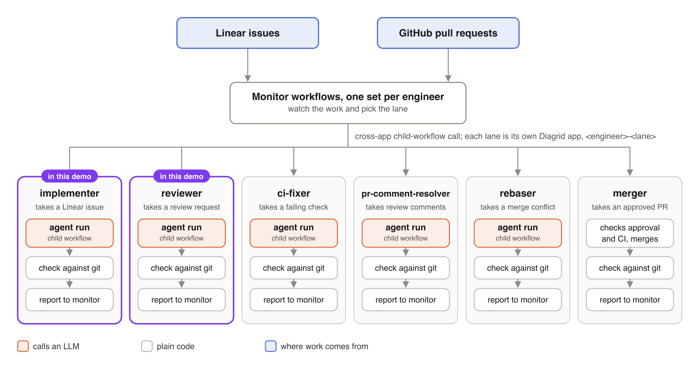

# Diagrid Agent Factory

Two LLM agents turn GitHub issues into pull requests and review pull requests.
A workflow written in plain Python runs every step around them: it checks their
changes, runs the tests, and waits for a person to reply `/approve` before it
opens a pull request. People choose the issues and do the merging.

It runs on [Dapr Workflows](https://docs.dapr.io/developing-applications/building-blocks/workflow/),
[Dapr Agents](https://github.com/dapr/dapr-agents) and
[Diagrid](https://www.diagrid.io/catalyst). Diagrid runs coding agents on its own
repositories the same way; this is a smaller version of that setup.



## How work moves

Label an issue `agent:implement`, or set `AUTO_PICKUP=true` and open one as an
owner, member or collaborator. The factory:

1. claims the issue and clones the repository,
2. runs an **implementer agent** that changes the code and adds a test,
3. checks the work itself: which files changed, and whether the tests pass,
4. runs a separate **reviewer agent** on the diff, and sends its findings back to the implementer (at most 2 rounds),
5. asks a person to reply `/approve` on the issue, with the diff attached,
6. pushes a branch and opens the pull request.

Label a pull request `agent:review` and the reviewer agent posts a review on it.

Every step leaves a comment on the issue, so the thread is the record of what
happened. When a limit runs out (no change, no approved change after 2 rounds,
a `/reject`, or no answer in 24 hours), the issue is labelled `agent:needs-human`.


## The workflows

Three workflows run the process. The two agents run as their child workflows.

```
issue_watch  (polls every 30 s, then continue-as-new)
 ├─ starts ─► implement_issue  issue-<repo>-<N>
 │              ├─ child ─► implementer agent  …-implement-<round>
 │              ├─ child ─► reviewer agent     …-review-<round>
 │              └─ waits for "approval"  ◄─ /approve or /reject
 └─ starts ─► review_pull_request  review-<repo>-<PR>-<sha>
                └─ child ─► reviewer agent     …-review
```

| Workflow | Runs | Activities | Child workflows | Waits |
|---|---|---|---|---|
| `issue_watch` | one, always on | `poll` | none | a 30 s timer, then continue-as-new |
| `implement_issue` | one per issue | `claim_issue`, `prepare_workspace`, `verify_workspace`, `comment`, `request_approval`, `open_pull_request`, `set_labels` | implementer and reviewer, once per round | the `approval` event or a 24-hour timer |
| `review_pull_request` | one per PR head commit | `fetch_pr`, `prepare_workspace`, `post_review` | reviewer | none |

`issue_watch` starts the other two as top-level runs with a fixed id, not as
children, so a restart of the watcher leaves them running. Inside each agent run,
every LLM call and every tool call is its own checkpointed step.

### What happens on a crash

Diagrid stores each completed step. If the worker dies mid-run, a new worker
picks every run up from its last completed step, including inside an agent's
run, so no LLM call or tool call is repeated. A run waiting a day for `/approve`
holds no process and survives any number of restarts.

## How the code is written

**Workflows decide the order** ([`factory/workflows.py`](factory/workflows.py)).
Each is a Python generator, and each `yield` is a durable step:

```python
def implement_issue(ctx, inp):
    issue = yield ctx.call_activity(act.claim_issue, input=..., retry_policy=RETRY)
    ws = yield ctx.call_activity(act.prepare_workspace, input=..., retry_policy=RETRY)
    for round_no in range(1, max_rounds + 1):
        result = yield ctx.call_child_workflow(implementer, input=task, instance_id=f"{iid}-implement-{round_no}")
        check = yield ctx.call_activity(act.verify_workspace, input=..., retry_policy=RETRY)
        review = yield ctx.call_child_workflow(reviewer, input=..., instance_id=f"{iid}-review-{round_no}")
        ...
    answer = ctx.wait_for_external_event("approval")
    timeout = ctx.create_timer(timedelta(hours=24))
    winner = yield wf.when_any([answer, timeout])
    pr = yield ctx.call_activity(act.open_pull_request, input=..., retry_policy=RETRY)
```

**Activities do the work** ([`factory/activities.py`](factory/activities.py)).
Each is a plain function, `(ctx, inp) -> dict`, that calls GitHub, runs git or
runs the tests. Nothing else in the code has side effects. Any workflow can call
any activity: `prepare_workspace` serves both `implement_issue` and
`review_pull_request`, so a new workflow mostly reuses steps that already exist.

**Agents are configuration** ([`agents/`](agents)). Each Markdown file holds an
agent's role, goal, tools, step limit and instructions.
[`factory/agents.py`](factory/agents.py) turns each one into a Dapr Agents
`DurableAgent`, so an agent run is itself a workflow:

```markdown
---
name: implementer
role: Software engineer
goal: Resolve one issue with a small, tested change to the code in the workspace.
tools: [list_files, read_file, search_code, write_file, run_tests]
max_iterations: 30
---
You are given one issue and a git checkout of the repository...
```

The five tools are in [`factory/tools.py`](factory/tools.py). The LLM behind
both agents is a setting: any model behind a Dapr Conversation component
(`AGENT_BACKEND=conversation`), or the Claude Agent SDK (`AGENT_BACKEND=claude`).
With the second, Claude Code's agent loop runs inside a durable workflow step on
your cluster instead of on a developer's machine.

## Practices it follows

| Practice | In this code | Skill |
|---|---|---|
| Workflow code is deterministic: no I/O, clock or randomness. Settings come in as input, so a replay takes the same path. | [`workflows.py`](factory/workflows.py) | [diagrid-workflow-determinism](https://github.com/diagridio/diagrid-ai/tree/main/skills/diagrid-workflow-determinism) |
| Every side effect is an activity that is safe to run twice: it finds an existing PR before opening one, and skips a push that already landed. Every call has a retry policy. | [`activities.py`](factory/activities.py) | [diagrid-activity-idempotency](https://github.com/diagridio/diagrid-ai/tree/main/skills/diagrid-activity-idempotency) |
| One run per work item: the run id comes from the issue number or the PR commit, so nothing is worked on twice. | `_start_once` in [`activities.py`](factory/activities.py) | |
| Agents run as child workflows, so a crash mid-agent resumes from its last LLM or tool call. | [`agents.py`](factory/agents.py) | [diagrid-agent-scaffold](https://github.com/diagridio/diagrid-ai/tree/main/skills/diagrid-agent-scaffold) |
| The workflow checks the agent's work against git and the test run instead of trusting its summary. A second agent with fresh context reviews it. | `verify_workspace` in [`activities.py`](factory/activities.py) | |
| A person approves through a workflow event, raced against a durable 24-hour timer. Nothing runs while it waits. | [`workflows.py`](factory/workflows.py) | [diagrid-workflow-scaffold](https://github.com/diagridio/diagrid-ai/tree/main/skills/diagrid-workflow-scaffold) |
| The long-running watcher calls continue-as-new so its history stays small, and is restarted when its settings change. | `issue_watch`, `_start_watch` in [`main.py`](factory/main.py) | |
| Least privilege: agents get five tools held to one folder. Only activities hold the GitHub token; it never enters workflow input or history. | [`tools.py`](factory/tools.py) | |
| Only owners, members and collaborators can start work or approve. The review bot comments; it never approves. | [`github.py`](factory/github.py) | |
| Work that has to outlive a restart is on durable storage: the agents' checkout stays on a persistent volume until `/approve` pushes it. | [`deploy/deployment.yaml`](deploy/deployment.yaml) | [diagrid-deploy](https://github.com/diagridio/diagrid-ai/tree/main/skills/diagrid-deploy) |

We have written all of these practices up as agent skills, so a coding agent
applies them when it writes or reviews workflow code. They are in
[diagridio/diagrid-ai](https://github.com/diagridio/diagrid-ai); install them in Claude Code with:

```bash
claude plugin marketplace add diagridio/diagrid-ai
```

```bash
claude plugin install diagrid@diagrid
```

## Extend it

- **Add an agent:** add a Markdown file to `agents/` and call it from a workflow with `call_child_workflow`.
- **Add a job:** a CI fixer, a review-comment responder or a rebase agent is one more workflow that reuses these activities, plus one agent file.
- **Change a policy:** open the PR without asking, require two approvers, auto-merge when the tests and the reviewer pass, or allow more rounds. Each is a few lines in `workflows.py`.
- **Use GitLab:** replace [`factory/github.py`](factory/github.py). The workflows reach it only through activities.
- **Scale out:** start more workers with the same app id, and Diagrid spreads the runs across them.
- **Split the agents out:** run each agent as its own Diagrid app and call it with a cross-app child workflow. That is how Diagrid runs it in production.

### How Diagrid runs it in production

Diagrid's own setup splits pull request work into **lanes**. A lane is one kind
of work, such as implement, review, fix CI, answer comments, rebase or merge.
Each lane has its own agent file and its own Diagrid app. A monitor workflow
hands each item to its lane with a cross-app child-workflow call; the lane runs
its agent as a child workflow, checks the result against git, and reports back.
This repository is the implementer and reviewer lanes in one service.



## Run your own copy

You need Python 3.11+, [uv](https://docs.astral.sh/uv/), the
[Diagrid CLI](https://docs.diagrid.io/catalyst/references/cli-reference/intro/),
a fork of this repository (the agents only change `sample-app/`), a GitHub
token with read and write access to its contents, issues and pull requests, and
an OpenAI key.

```bash
diagrid login
diagrid project create agent-factory --enable-managed-workflow --deploy-managed-kv --wait
diagrid appid create agent-factory --project agent-factory --wait
diagrid component create llm-provider --type conversation.openai --project agent-factory \
  --metadata key="$OPENAI_API_KEY" --metadata model=gpt-4.1 --wait
```

```bash
export DAPR_API_TOKEN="$(diagrid appid get agent-factory -p agent-factory -o json | jq -r .status.apiToken)"
export DAPR_GRPC_ENDPOINT="$(diagrid project get agent-factory -o json | jq -r .status.endpoints.grpc.url)"
export DAPR_HTTP_ENDPOINT="$(diagrid project get agent-factory -o json | jq -r .status.endpoints.http.url)"
export TARGET_REPO=<you>/diagrid-agent-factory GITHUB_TOKEN=<token> AGENT_BACKEND=conversation
uv sync && uv run python -m factory.main
```

The worker creates the `agent:*` labels on first start. Open one of the issue
templates in your fork (**New issue → Demo 1**), label it `agent:implement`, and
follow the run in the Diagrid console. The [`Dockerfile`](Dockerfile) and
[`deploy/`](deploy) run the same worker on Kubernetes.

## Layout

```
agents/              agent definitions
factory/
  main.py            worker: builds the agents, registers workflows and activities
  workflows.py       issue_watch, implement_issue, review_pull_request
  activities.py      every side effect: GitHub, git, tests
  agents.py          agents/*.md -> DurableAgent
  tools.py           the tools agents may call, held to the checkout
  github.py          the GitHub calls
  prompts.py         task text and verdict parsing
sample-app/          the code the agents work on, with three seeded issues in .github/ISSUE_TEMPLATE
scripts/             reset_demo.py and the seeded issues
Dockerfile, deploy/  the worker on Kubernetes
```
