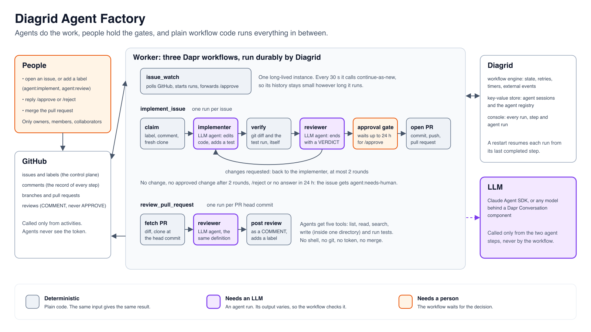

# Diagrid Agent Factory

Two LLM agents turn GitHub issues into pull requests and review pull requests.
A workflow runs every step around them: it checks their changes, runs the tests,
and waits for a person to reply `/approve` before it opens a pull request.
People choose the issues and do the merging.

It runs on [Dapr Workflows](https://docs.dapr.io/developing-applications/building-blocks/workflow/),
[Dapr Agents](https://github.com/dapr/dapr-agents) and
[Diagrid](https://www.diagrid.io/catalyst). Diagrid runs coding agents on its own
repositories the same way; this is a smaller version of that setup.

## What runs

The demo runs all the time, so there is nothing to start.

| Piece | What it is |
|---|---|
| Worker | One pod on Diagrid's demo Kubernetes cluster, namespace `agent-factory`: the three workflows and both agents. Argo CD deploys it from `deploy/` on every merge to `main`. |
| Diagrid | Project `agent-factory`. It runs the workflows and keeps their state, so a run survives a restart of the pod. |
| GitHub | This repository. The worker watches its issues and pull requests, and comments and pushes as a bot account. |
| LLM | OpenAI `gpt-4.1`, through the Dapr Conversation component `llm-provider` in the Diagrid project. |

How it is deployed, and its secrets: [deploy/README.md](deploy/README.md).

## Run the demo

1. **Reset.** Open **Actions → [Reset demo](https://github.com/diagrid-labs/diagrid-agent-factory/actions/workflows/reset-demo.yaml) → Run workflow**,
   pick an issue and keep **start** ticked. The reset stops the agents' running
   workflows, closes their issues and pull requests, deletes their `agent/*`
   branches, puts the bugs back in `sample-app/`, and opens the issue you picked
   with the `agent:implement` label. The run's summary lists what it closed and opened.
2. **Watch the issue.** Within 30 seconds the worker claims it and comments with
   its workflow id. Each implementer and reviewer round is posted as a comment.
3. **Show the run.** In the Diagrid console, project `agent-factory`, **Workflows**:
   the run for the issue shows each step, the two agent runs, and the wait for approval.
4. **Approve.** When the issue asks, reply `/approve` as an org member, and the
   workflow opens the pull request. `/reject` stops it.
5. **Review bot.** Label any pull request `agent:review` and the reviewer agent
   posts a review on it.

You can also open your own issue on this repository as an org member. The worker
picks it up without a label.

Pick one seeded issue to know which pull request to expect. Each has a single
clear fix, though the code differs a little between runs, since the agents are LLMs.

## Who does what


## How work moves

Label an issue `agent:implement` and the factory works on it. With
`AUTO_PICKUP=true` it starts as soon as an owner, member or collaborator opens
the issue. The factory:

1. claims the issue and clones the repository,
2. runs an **implementer agent** that changes the code and adds a test,
3. checks the work itself: which files changed, and whether the tests pass,
4. runs a separate **reviewer agent** on the diff, and sends its findings back to the implementer (up to 2 rounds),
5. asks a person to reply `/approve` on the issue, with the diff attached,
6. pushes a branch and opens the pull request.

Label a pull request `agent:review`, whoever opened it, and the reviewer agent
posts a review on it.

Every step leaves a comment on the issue, so the thread is the record of what
happened and why. When a limit runs out (no change, no approved change after 2
rounds, a `/reject`, or no answer in 24 hours), the issue is labelled
`agent:needs-human` with the agent's last summary.



The two agent steps are the only ones that call an LLM. Each runs as a child
workflow; every other step is a workflow activity in plain code.

## The rules, and where they live

| Rule | Where |
|---|---|
| **The workflow owns the process.** The order of steps, the review loop, the round limit and the approval gate are plain code. The agents never decide whether they are done. | [`factory/workflows.py`](factory/workflows.py) |
| **The workflow checks the agent's work.** After the implementer finishes, the workflow lists the changed files and runs the tests itself. | `verify_workspace` in [`factory/activities.py`](factory/activities.py) |
| **A fresh reviewer.** A second agent with no shared context reviews the diff and ends with `VERDICT: APPROVE` or `REQUEST_CHANGES`. | [`agents/reviewer.md`](agents/reviewer.md) |
| **Least privilege.** Agents get five tools: list, read, search, write (inside one directory only) and run tests. They never see the GitHub token and cannot run git, push, label or merge. With the Claude backend, Claude's own shell and edit tools are switched off. | [`factory/tools.py`](factory/tools.py) |
| **Only trusted people count.** Only `/approve` and `/reject` from owners, members and collaborators count, and `AUTO_PICKUP` only picks up issues they opened. The review bot comments; it never approves, so it does not count toward branch protection. | [`factory/github.py`](factory/github.py) |
| **Agents are configuration.** Each agent's role, goal, tools, iteration limit and instructions live in one file. Add a file to add an agent. | [`agents/`](agents) |
| **One run per work item.** An issue or a PR head commit is one workflow instance with a stable id, so the same item is never worked on twice. | `_start_once` in [`factory/activities.py`](factory/activities.py) |

Each of these is a policy you can change in a few lines: open the PR without
asking, ask two people, auto-merge when the tests and the reviewer pass, or allow
more rounds.

## Extending it

The same pattern covers more of the pull request lifecycle. Diagrid's own setup
also has agents that fix failing CI, answer review comments and rebase
conflicting pull requests. Each is one more workflow that reuses the activities
here, plus one more file in `agents/`.

To use GitLab instead of GitHub, replace [`factory/github.py`](factory/github.py).
The workflows only call it through the activities, and need the same few calls
against the GitLab API: list issues by label, comment, set labels, open a merge
request, post a review note.

## Why workflows

Each step runs on Diagrid as a durable workflow step, so the rules hold across
restarts. An agent run, a review round or a day-long wait for approval survives a
restart of the worker and continues from its last completed step, without
repeating work. Start more workers with the same app id
and Diagrid spreads the runs across them. Every run, step and agent run shows
in the Diagrid console.

## Layout

```
agents/              agent definitions (the factory's input)
factory/
  main.py            worker: builds the agents, registers workflows and activities
  workflows.py       issue_watch, implement_issue, review_pull_request
  activities.py      every side effect: GitHub, git, tests
  agents.py          agents/*.md -> DurableAgent (Claude or Dapr Conversation)
  tools.py           the tools agents may call, held to the checkout
  github.py          the GitHub calls; swap for GitLab merge requests
  prompts.py         task text and verdict parsing (pure functions)
sample-app/          the code the agents work on, with tests
scripts/             seed_issues.py, reset_demo.py (what Reset demo runs), setup_diagrid.sh
dev-diagrid.yaml     run file for `diagrid dev run` (docs/local.md)
Dockerfile, deploy/  the hosted copy on Kubernetes, synced by Argo CD (deploy/README.md)
```

To work on the factory itself, run a copy on your laptop: [docs/local.md](docs/local.md).
