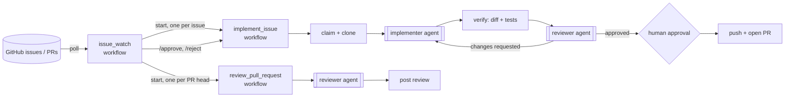

# Catalyst Agent Factory

Coding agents that pick up issues and open pull requests, plus a code review bot,
built on [Dapr Workflows](https://docs.dapr.io/developing-applications/building-blocks/workflow/),
[Dapr Agents](https://github.com/dapr/dapr-agents) and
[Diagrid Catalyst](https://www.diagrid.io/catalyst).

Label an issue `agent:implement` and the factory:

1. claims the issue and clones the repository,
2. runs an **implementer agent** that changes the code and adds a test,
3. checks the work itself: what changed, and whether the tests pass,
4. runs a separate **reviewer agent** on the diff, and loops back to the implementer with the findings (up to 2 rounds),
5. waits for a person to reply `/approve` on the issue,
6. pushes a branch and opens the pull request.

Label a pull request `agent:review` and the reviewer agent posts a review on it.

Every step is a durable workflow step on Catalyst. Stop the worker at any point,
even in the middle of an agent run or while it waits for approval, start it again,
and each run carries on from its last completed step.



`[[ ]]` are agent runs, each a child workflow. Everything else is a workflow activity.

## What this shows

| | How |
|---|---|
| **An agent factory** | Each file in [`agents/`](agents) defines one agent: role, goal, tools, iteration limit and instructions. [`factory/agents.py`](factory/agents.py) turns each file into a `DurableAgent`. Add a file to add an agent. |
| **Durable agents** | Each agent run is a child workflow. With the Claude backend, the Claude session is stored in the Catalyst state store, so a run resumes on any host. With the Conversation backend, every LLM call and every tool call is its own checkpointed activity. |
| **Workflow owns the process, agents own the judgment** | The order of steps, the review loop, the retry limits and the approval gate are plain workflow code ([`factory/workflows.py`](factory/workflows.py)). The agents never decide whether they are done. |
| **Don't trust, verify** | After the implementer finishes, the workflow lists the changed files and runs the tests itself. "No change" or "tests failing" is a fact the workflow sees, not something the agent reports. |
| **Least privilege** | Agents get five tools ([`factory/tools.py`](factory/tools.py)): list, read, search, write (inside the scope directory only) and run tests. They never see the GitHub token and cannot run git, push or open PRs. The workflow does those steps after the checks pass. With the Claude backend, Claude's own Bash/Edit/Read tools are switched off. |
| **Human in the loop** | The workflow waits for `/approve` or `/reject` on the issue (`wait_for_external_event` with a 24h timer). Waiting costs nothing, and it survives restarts. Only comments from owners, members and collaborators count. |
| **Idempotent side effects** | Activities run at least once. Each one is safe to repeat: re-clone instead of reusing a half-made checkout, skip an empty commit, reuse an open PR. |
| **Scale out** | Start a second worker with the same app id and Catalyst spreads runs across both. |

## Run it

You need Python 3.11+, [uv](https://docs.astral.sh/uv/), the [Diagrid CLI](https://docs.diagrid.io/catalyst/references/cli-reference/intro/), a Catalyst organization, and a GitHub repository you can push to (a fork of this one works: the agents only change `sample-app/`).

```bash
git clone https://github.com/diagrid-labs/catalyst-agent-factory && cd catalyst-agent-factory
uv sync
cp .env.example .env        # set TARGET_REPO to your fork
diagrid login
```

Pick how the agents think (`AGENT_BACKEND` in `.env`):

- `claude` (default): the Claude Agent SDK, using this machine's Claude login, or `CLAUDE_CODE_OAUTH_TOKEN` / `ANTHROPIC_API_KEY`. Nothing to create in Catalyst.
- `conversation`: any LLM behind a Dapr Conversation component (OpenAI, Anthropic, Bedrock, Azure OpenAI, Ollama, ...). Create it with:

  ```bash
  OPENAI_API_KEY=... scripts/setup_catalyst.sh agent-factory      # or ANTHROPIC_API_KEY=...
  ```

Start the worker on your laptop, connected to Catalyst:

```bash
diagrid dev run --project agent-factory --file dev-catalyst.yaml --approve
```

The first run creates the project's app id, the managed state store and the `agent:*` labels on the repository. Then open the demo issues and hand them to the implementer:

```bash
uv run python scripts/seed_issues.py --label
```

Follow along on the issues (each round's review is posted as a comment), in the worker's log, and in the Catalyst console's workflow view. Reply `/approve` on an issue when asked, and a PR appears.

### The crash demo

1. Label an issue `agent:implement`.
2. While the implementer is working, or while the issue waits for `/approve`, press Ctrl-C on the worker.
3. `diagrid workflow list` shows the run still `running` in Catalyst: its state is there, not on the laptop.
4. Reply `/approve` while the worker is down, if it was waiting.
5. Start the worker again. The run continues from the step it was on. Finished steps are not repeated: no second clone, no second agent run, no duplicate comments.

## Layout

```
agents/              agent definitions (the factory's input)
factory/
  main.py            worker: builds the agents, registers workflows and activities
  workflows.py       issue_watch, implement_issue, review_pull_request
  activities.py      every side effect: GitHub, git, tests
  agents.py          agents/*.md -> DurableAgent (Claude or Dapr Conversation)
  tools.py           the tools agents may call, held to the checkout
  github.py          the GitHub calls; swap for GitLab merge requests
  prompts.py         task text and verdict parsing (pure functions)
sample-app/          the code the agents work on, with tests
scripts/             seed_issues.py, setup_catalyst.sh
dev-catalyst.yaml    run file for `diagrid dev run`
```

### GitLab instead of GitHub

The workflows only call [`factory/github.py`](factory/github.py) through the activities. A GitLab version needs the same few calls (list issues by label, comment, set labels, open a merge request, post a review note) against the GitLab API. The workflows, agents and tools stay as they are.

## Catalyst, Temporal and LangGraph Platform for an agent factory

All three give you durable execution, so a long agent run survives a crash and can wait for a person. They differ in what else you get and what you have to build yourself.

| | Diagrid Catalyst | Temporal | LangGraph Platform |
|---|---|---|---|
| Durable execution model | Dapr Workflows: workflows as code, replayed from history; activities, child workflows, timers, external events | Temporal workflows: the same model, very mature | Checkpoints after each graph step; interrupts for human input |
| Agent layer | Dapr Agents (`DurableAgent`), plus durable runtimes for LangGraph, CrewAI, OpenAI Agents SDK and others; agent registry in the console | Bring your own. LLM and tool calls become activities you write; integrations exist for some SDKs | LangGraph graphs; tight LangSmith tracing and evaluation |
| LLM access | Conversation API: one interface to many providers, switched by component config | Your own clients | LangChain model integrations |
| Beyond workflows | The rest of Dapr: pub/sub, state, service invocation with mTLS and app identity across clusters, secrets, MCP servers, token budgets | Workflows only; messaging and service-to-service calls are separate systems | Agent hosting: threads, cron, task queue |
| Languages | Python, .NET, Java, Go, JavaScript | Go, Java, Python, TypeScript, .NET, PHP, Ruby | Python, JavaScript |
| Hosting | Managed, BYOC in your cloud, or fully self-hosted (Enterprise Server) | Temporal Cloud or self-hosted cluster | Managed cloud, hybrid, or self-hosted |

Where Catalyst fits best:

- **Agents that are part of a larger system.** The coding agent is one step. Around it sit plain deterministic steps (claim, clone, test, push), approvals, and calls to other services. Catalyst runs all of that in one workflow and gives those services messaging and secure service-to-service calls, across clusters as well.
- **Teams already on Dapr.** You are already running Dapr OSS. Catalyst runs the same Dapr APIs and the same SDKs, so a prototype like yours runs unchanged, and the workflow engine, state and identity are managed for you.
- **Many agents, many teams.** An agent factory means many agents built on different frameworks by different teams. Catalyst runs them side by side with one registry, one console for workflow runs, and one set of policies, without standardizing everyone on one agent framework.

Temporal is a strong choice if you are already standardized on it and want to write the agent layer yourself. LangGraph Platform fits a team that builds everything in LangGraph and wants LangSmith at the center. On Catalyst, LangGraph agents can run durably as well.
